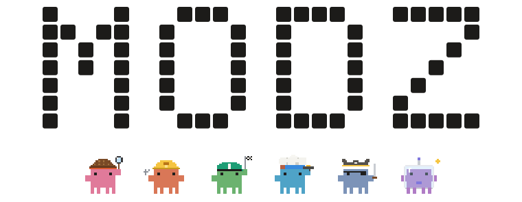
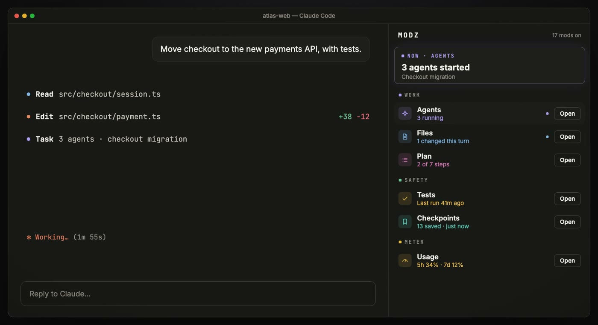
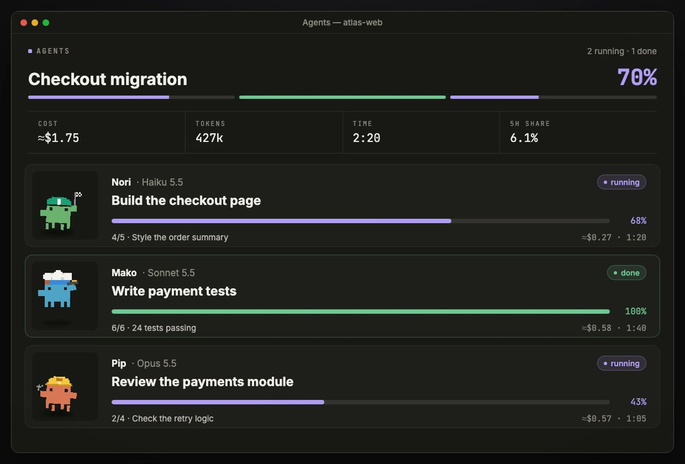
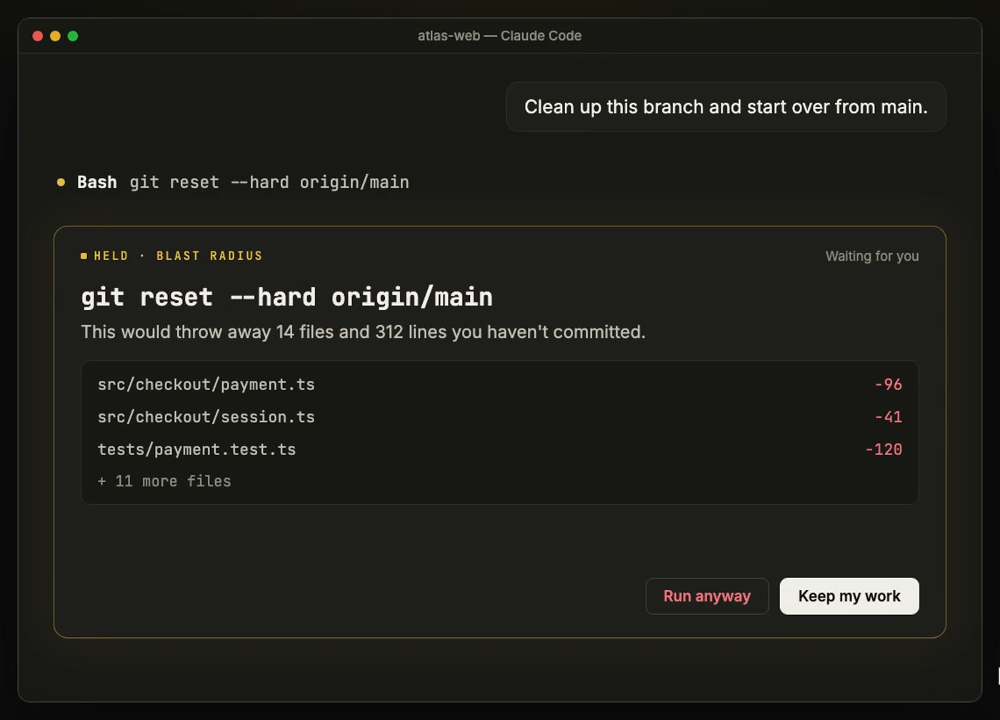
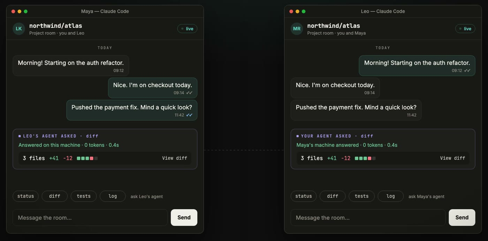

<p align="center">
  <picture>
    <source media="(prefers-color-scheme: dark)" srcset="docs/img/hero-dark.svg">
    
  </picture>
</p>

<h3 align="center">19 mods for Claude Code. One panel.</h3>

<p align="center">See every move Claude makes: agents, files, plans, tests and risky commands, live, beside the chat.</p>

<p align="center">
  <a href="https://partalemre.github.io/MODZ/"></a>
  <br>
  <sub><a href="https://partalemre.github.io/MODZ/">Watch the whole film</a> · 54 seconds, with sound · <a href="https://github.com/partalemre/MODZ/releases/latest">download it</a></sub>
</p>

## Install

In Claude Code, add the marketplace, then install the panel and the mods you want:

```text
/plugin marketplace add partalemre/MODZ
/plugin install modz@modz
/plugin install savvy-progress@modz
```

Or install all of them at once from a terminal:

```sh
claude plugin marketplace add partalemre/MODZ
for m in modz savvy-progress savvy-flow filetree plan-steps handoff transceiver blast-radius secret-guard checkpoint \
         test-badge replay-theater session-budget cache-tax hud-pro effort-router done-ping reflect-mod skins terminal-browser; do
  claude plugin install "$m@modz"
done
```

Or ask your coding agent: *Install MODZ for me. Follow https://partalemre.github.io/MODZ/llms.txt and ask me which mods I want.*

Start a new session. The MODZ panel opens on the right with a line from every mod you installed.

- **Where it draws.** The Claude desktop app's Code tab draws everything. The terminal draws the same panels as text.
- **Requirements.** Claude Code 2.1.295 or later, tested on 2.1.295 and 2.1.296. `terminal-browser` draws in the terminal only. Outside the desktop app, `done-ping` falls back to a macOS banner.
- **Language.** The interface is in English. Set `MODZ_LANG=tr` for Turkish.
- **Transceiver** needs a claude.ai login. If Claude Code runs inside another app (an IDE, `claude -p`, an SDK host), also set `CLAUDE_CODE_ARTIFACT=1`.

Both variables go in the `env` block of `~/.claude/settings.json`:

```json
{ "env": { "MODZ_LANG": "tr", "CLAUDE_CODE_ARTIFACT": "1" } }
```

## One panel. Every mod, live.



The panel opens beside the chat when a session starts. Each mod reports one honest line: what it measured, never a guess. One click opens that mod's own pane next to the panel.

## Every agent gets a face.



Each subagent gets a crab, a name and a card with its task, step, progress, cost and time, updated as it works. A band above the prompt shows the whole crew while a turn runs.

## Risky commands wait for your OK.



`rm -rf`, `git reset --hard`, `git clean`, force pushes and migrations stop before they run. The card shows exactly what each would delete or throw away, and the safe choice has the focus.

## Your team, inside Claude. <sup>beta</sup>



Transceiver lets you chat with teammates without leaving Claude Code. Your agent can ask theirs for `status`, `diff`, `tests`, `log` or a file. The answer is computed on their machine and costs zero tokens. Only collaborators on the repo can ask, and secrets never leave your machine. Rooms are private claude.ai artifacts; there is no extra server. Transceiver is in beta: it works end to end, and its rough edges are being found. [How it works](https://github.com/partalemre/transceiver)

## The mods

| | Mod | What it does |
|---|---|---|
| **Panel** | `modz` | The panel itself: one live line per mod and one click to each pane |
| **Work** | `savvy-progress` | Agents pane and progress band: each subagent's progress, cost and time; other chats waiting on you; a home crab that levels up |
| | `savvy-flow` | Orchestrated delivery: the session model plans, tiered worker agents build |
| | `filetree` | Files Claude touched this turn, what it is doing now, git status |
| | `plan-steps` | The plan's steps as Claude works through them; the plan comes back after `/clear` and compaction, and a turn that ends with steps open offers to go on |
| | `handoff` | Before the context fills, writes a handoff note and hands it once to your next fresh chat |
| | `transceiver` | Team chat and zero-token agent questions between teammates (beta) |
| **Safety** | `blast-radius` | Holds destructive shell commands and shows what they would change; holds an edit to a file another chat just changed; checks other commands against your `.claude/house-rules.md` |
| | `secret-guard` | Stops keys and tokens in writes, edits, `git add` and commits; keeps pasted keys out of the chat as placeholders; `/rec` masks keys, env values and e-mail addresses on screen |
| | `checkpoint` | A silent git snapshot before each turn's first write; undo a turn |
| | `test-badge` | Runs tests and lint after edits and shows the result; watches your PR's GitHub CI |
| | `replay-theater` | Replays the last turn's edits step by step, and earlier turns and past sessions |
| **Meter** | `session-budget` | A spend budget per session, with a stop at 100% |
| | `cache-tax` | Keeps the prompt cache warm through breaks and prices a cold send, a model change included |
| | `hud-pro` | One line with the 5-hour and 7-day limits, context and cost; when the 5-hour window fills; what fills the context and how many turns are left |
| | `effort-router` | Shows each turn's effort and model; can send light prompts at low effort |
| **Comfort** | `done-ping` | A notification when a long turn ends or Claude waits on you, with optional sound packs |
| | `reflect-mod` | Saves corrections worth keeping to your CLAUDE.md; `/mine` turns friction that repeats across past chats into ideas |
| | `skins` | Themes for the transcript, switched live with `/skin` |
| | `terminal-browser` | A browser inside the terminal that the agent can drive |

Most mods use no model tokens. These can, each with the cheapest model and never more than one call per event:

- `reflect-mod`: one small check per correction it finds, and one per `/mine`.
- `cache-tax`: warming sends a request, only when you turn it on.
- `handoff`: one summary per handoff note (`summarize`, on by default; the note is written without it too).
- `effort-router`: one check per prompt, only in `auto` mode.
- `blast-radius`: one check per command it judges, only when `.claude/house-rules.md` exists.
- `replay-theater`: one call when a step has no description of its own.
- Transceiver's free-form `ask`: a small model on the other side, at most ten a day per room.

`plan-steps` (while it brings a plan back) and `secret-guard` (while placeholders exist) add a short section to the system prompt.

### What each mod can touch

Read from the code, not from a promise. "Store" is the mod's own file in `~/.claude`; every mod also keeps session state in memory.

| Mod | Reads | Writes | Runs | Network | Model |
|---|---|---|---|---|---|
| `modz` | marketplace, settings | store | | | |
| `savvy-progress` | transcript | store | | | agents you start |
| `savvy-flow` | | | | | its worker agents |
| `filetree` | project files | | `git`, `open` | | |
| `plan-steps` | task list, plan file | store | | | |
| `transceiver` | repo, git | its room | `git` | claude.ai | free-form `ask` |
| `handoff` | transcript, plan | `.claude/handoff/*.md`, store | `git status`, `rm` (own notes) | | optional |
| `blast-radius` | `.claude/house-rules.md` | store | `git`, a read-only look at what a held command would touch | Jev, opt-in | with house rules |
| `secret-guard` | written files | `.env`, `.gitignore` (on your press) | `git` | | |
| `checkpoint` | | store, git refs | `git` | | |
| `test-badge` | project files | store | your test and lint commands, `git`, `gh` | GitHub, through `gh` | |
| `replay-theater` | transcripts | store | | | rarely |
| `session-budget` | | store | | | |
| `cache-tax` | | store | | | when warming |
| `hud-pro` | context breakdown | store | | | |
| `effort-router` | prompts | store | | Jev, opt-in | `auto` only |
| `done-ping` | | store | `osascript`, `terminal-notifier`, `afplay` | | |
| `reflect-mod` | transcripts, CLAUDE.md | CLAUDE.md (on your press), store | `tail` | | yes |
| `skins` | settings | store | | | |
| `terminal-browser` | web pages | | a browser | yes | |

Jev is TypeSafe's classifier: set `MODZ_JUDGE=jev` and `TYPESAFE_API_KEY` to use it instead of your own model account. What it is sent is masked first.

## Make it yours

- **Arrange the panel.** Press **Customize** at the bottom of the MODZ panel: move rows up, hide the ones you do not use, and bring them back from **Hidden**. **Reset** puts everything back. Your layout is kept across sessions.
- **Get back from any pane.** Every pane the panel opens has a **← MODZ** button at the top. It brings the panel forward, and opens it again if it was closed. `/modz` does the same.
- **Choose what loads.** Each mod is its own plugin: install or uninstall any of them, and the panel follows. `/plugin configure modz@modz` turns off opening at session start.

## Add your own mod to the panel

The panel lists any mod that reports to it, with no change to MODZ. Your mod talks to it through `$.state`:

1. **Report a line.** Write your own `{ plugin: '<your-mod>', key: 'hub' }` value: `{ pane, detail, tone, at }`, plus your row's `title`, `hint`, `icon` (a kit icon name), `section` (`work`, `safety` or `meter`) and an optional `badge`. `tone` is `idle`, `live`, `ok`, `warn` or `bad`; write it only when the text changes.
2. **Open on request.** Hook `state.set` on `{ plugin: 'modz', key: 'open' }`; when its `pane` is yours, call `$.ui.open({ id, title, focus: true })`.
3. **Offer the way back.** While `{ plugin: 'modz', key: 'isOn' }` is `true`, draw `HomeButton` from [`kit/home.tsx`](kit/home.tsx) first in your pane; its press writes your own `{ plugin: '<your-mod>', key: 'home' }` as `{ at }`.

[DESIGN.md §9](DESIGN.md) has the full contract, and [`mods/modz/types/index.d.ts`](mods/modz/types/index.d.ts) the types. `bin/modz new <name>` starts a mod from the template.

## For AI agents

If a person asks you to install MODZ, do exactly this. Every step is safe to repeat.

1. Check the version: `claude --version` must print 2.1.295 or later. If it is older, ask the person to update Claude Code first.
2. Add the marketplace: `claude plugin marketplace add partalemre/MODZ`.
3. Install the panel: `claude plugin install modz@modz`. Then install each mod the person wants, by the names in the table above, as `claude plugin install <name>@modz`. If they did not choose, install all twenty with the loop under [Install](#install).
4. Optional settings: put them in the `env` block of `~/.claude/settings.json`, merging with what is already there and never overwriting it:
   - `"MODZ_LANG": "tr"` for a Turkish interface.
   - `"CLAUDE_CODE_ARTIFACT": "1"` if Transceiver is installed and this Claude Code is driven by an SDK host.
5. Verify: `claude plugin list` shows each `<name>@modz` as enabled.
6. Tell the person to start a new session, or run `/reload-plugins` in an open one.

To remove a mod: `claude plugin uninstall <name>@modz`. To remove everything: also run `claude plugin marketplace remove modz`. A machine-readable summary is at [partalemre.github.io/MODZ/llms.txt](https://partalemre.github.io/MODZ/llms.txt).

## Develop

`mods/<name>/` holds each mod; `kit/` is the shared drawing kit, copied into the mods by `bin/kit-sync`.

- **Unit checks.** `bin/modz check [name]` validates each mod and runs its tests, on both the terminal engine and the desktop app's engine.
- **End to end.** `bin/modz desk` starts a real session, speaks the desktop app's own protocol to it, and clicks through every panel. Run both before opening a pull request.
- **Types.** Claude Code writes its API types into `.claude-plugin/types/` beside a mod it hot-reloads. Each mod's `tsconfig.json` extends them, so `tsc -p mods/<name>` type-checks that mod.
- **Kit gallery.** `tools/kit-gallery` draws every kit component; its tests check contrast in both themes.
- **Design rules.** [DESIGN.md](DESIGN.md) (in Turkish) covers colour, type, components and the rules every mod follows.

## Credits

Several mods are adaptations of open-source projects, each under its original license, which lives in that mod's folder:

| Mod | Based on | License |
|---|---|---|
| `blast-radius`, `replay-theater` | [anthropics/claude-code-playground](https://github.com/anthropics/claude-code-playground) | Apache-2.0 |
| `cache-tax` | [karanb192/cache-tax](https://github.com/karanb192/cache-tax) | MIT |
| `filetree` | [data-goblin/claude-code-filetree](https://github.com/data-goblin/claude-code-filetree) | MIT |
| `reflect-mod` | [bayramannakov/claude-reflect](https://github.com/bayramannakov/claude-reflect) | MIT |
| `savvy-progress`, `savvy-flow` | [johnnyvizz/claude-kit](https://github.com/johnnyvizz/claude-kit) | MIT |
| `skins` | [hellosverre/claude-skins](https://github.com/hellosverre/claude-skins) | MIT |
| `terminal-browser` | [zenbu-labs/terminal-browser](https://github.com/zenbu-labs/terminal-browser) | MIT |

Everything else is [MIT](LICENSE).
