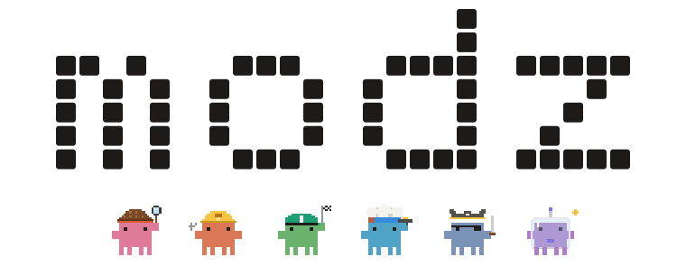
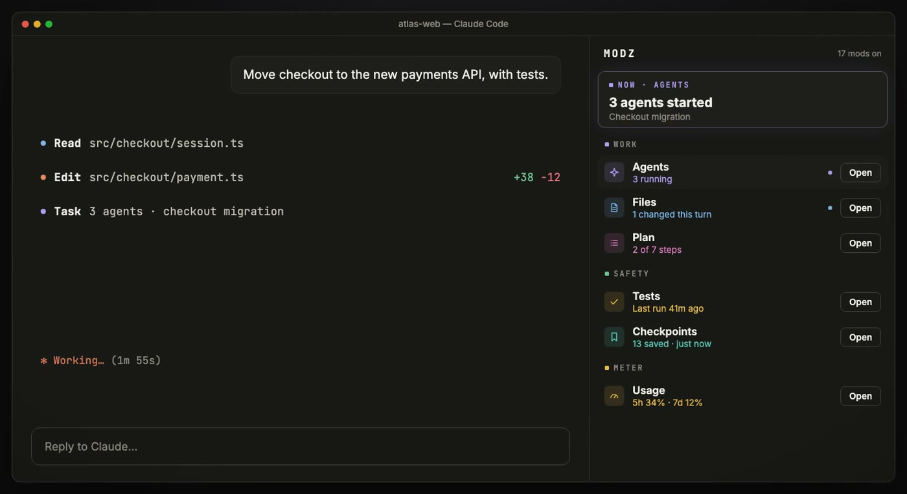
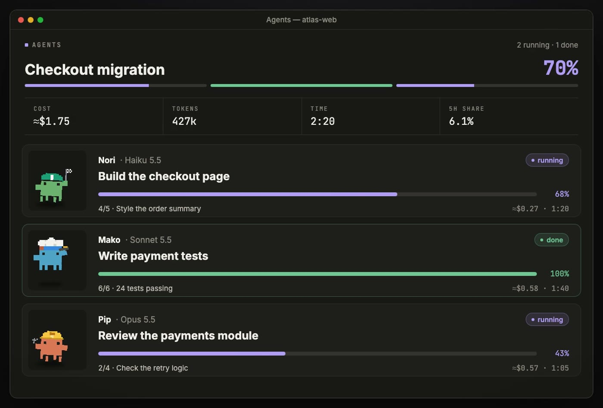
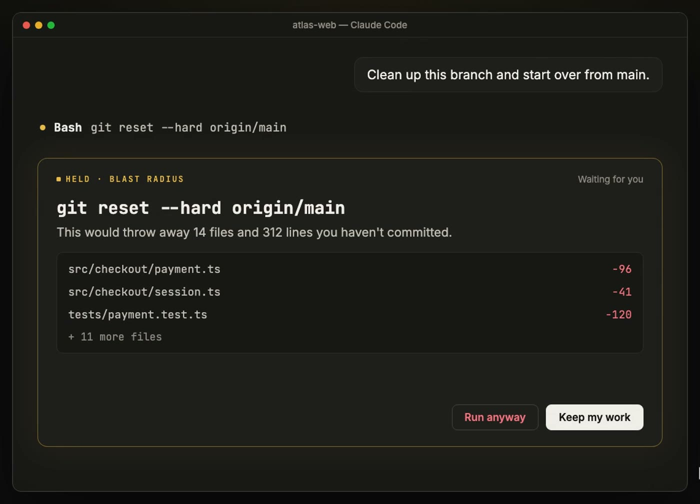
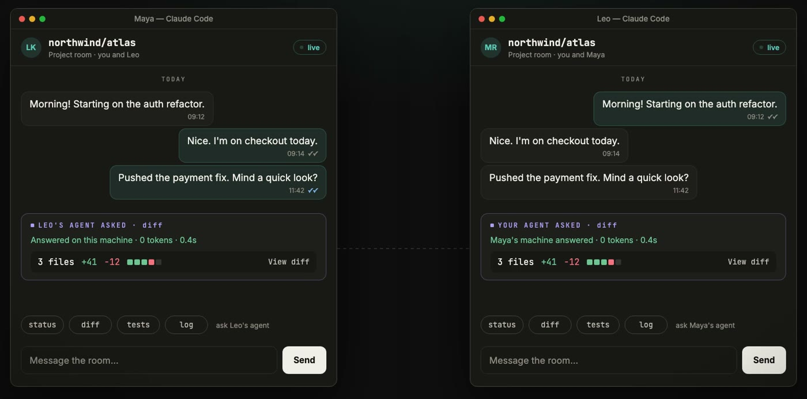

<p align="center">
  <picture>
    <source media="(prefers-color-scheme: dark)" srcset="docs/img/hero-dark.svg">
    
  </picture>
</p>

<h3 align="center">23 mods for Claude Code. One panel.</h3>

<p align="center">See every move Claude makes: agents, files, plans, tests and risky commands, live, beside the chat.</p>

<p align="center">
  <a href="https://partalemre.github.io/MODZ/"></a>
  <br>
  <sub><a href="https://partalemre.github.io/MODZ/">Watch the whole film</a> · 73 seconds, with sound · <a href="https://github.com/partalemre/MODZ/releases/latest">download it</a></sub>
</p>

## Install

Start with the core set: the panel, the agents and plan panes, the file tree, and three safety nets (risky commands, secrets in writes, undo). In Claude Code, add the marketplace, then install them:

```text
/plugin marketplace add partalemre/MODZ
/plugin install modz@modz
/plugin install savvy-progress@modz
/plugin install plan-steps@modz
/plugin install filetree@modz
/plugin install blast-radius@modz
/plugin install secret-guard@modz
/plugin install checkpoint@modz
/plugin install hud-pro@modz
```

Or do the same from a terminal:

```sh
claude plugin marketplace add partalemre/MODZ
for m in modz savvy-progress plan-steps filetree blast-radius secret-guard checkpoint hud-pro; do
  claude plugin install "$m@modz"
done
```

The other 15 mods are optional extras. Add any of them by name, or all of them with one loop:

```sh
for m in savvy-flow projects handoff transceiver test-badge pr-card replay-theater \
         session-budget cache-tax effort-router done-ping reflect-mod skins wrapped terminal-browser; do
  claude plugin install "$m@modz"
done
```

Or ask your coding agent: *Install modz for me. Follow https://partalemre.github.io/MODZ/llms.txt and ask me which mods I want.*

Start a new session. The modz panel opens on the right with a line from every mod you installed.

- **Where it draws.** The Claude desktop app's Code tab draws everything. The terminal draws the same panels as text.
- **Requirements.** Claude Code 2.1.295 or later, tested on 2.1.296 (terminal) and 2.1.317 (desktop app). `terminal-browser` draws in the terminal only and needs the external `terminal-browser` CLI (without it, the mod asks you to install it first). Outside the desktop app, `done-ping` falls back to a macOS banner.
- **Updates.** Automatic and free. The first session after you install turns on Claude Code's own auto-update for the `modz` marketplace, so every mod you installed, `transceiver` from its own repo included, updates itself in the background a few minutes into a session and loads fresh at the next start. No model call, no command to run. If you already chose under `/plugin` > Marketplaces, that choice stays; to turn it off, choose **Disable auto-update** there.
- **Language.** The interface is in English. Set `MODZ_LANG=tr` for Turkish.
- **Transceiver** (an extra, kept in its own repo) needs a claude.ai login. If Claude Code runs inside another app (an IDE, `claude -p`, an SDK host), also set `CLAUDE_CODE_ARTIFACT=1`.

Both variables go in the `env` block of `~/.claude/settings.json`:

```json
{ "env": { "MODZ_LANG": "tr", "CLAUDE_CODE_ARTIFACT": "1" } }
```

## One panel. Every mod, live.



The panel opens beside the chat when a session starts. If a mod does not open its pane, its row says so instead of doing nothing. Each mod reports one honest line: what it measured, never a guess. One click opens that mod's own pane next to the panel.

- **Now.** The top of the panel shows what is happening without opening anything: a failing or warning mod first, each running agent with its task, time and cost, the plan's current step, and your usage. Press a line for the detail.
- **Commands and settings.** `/modz help` prints every installed mod's slash commands and the options it has under `/plugin`. The Mods pane shows the same, and for each mod you have not installed, the line that installs it with a Copy button.

## Every agent gets a face.



Each subagent gets a crab, a name and a card with its task, step, progress, cost and time, updated as it works. A band above the prompt shows the whole crew while a turn runs.

## Risky commands wait for your OK.



`rm -rf`, `git reset --hard`, `git clean`, force pushes and migrations stop before they run. The card shows exactly what each would delete or throw away, and the safe choice has the focus. A command that would lose nothing just runs.

## Your computers, and your team, inside Claude. <sup>beta</sup>



Transceiver first links your own computers: sessions on, say, a Mac and a Windows PC under the same claude.ai account can chat, and one agent can ask the other for `status`, `diff`, `tests`, `log` or a file. The answer is computed on the other machine and costs zero tokens. Team rooms across different accounts use the same mechanism and are experimental. Only collaborators on the repo can ask, and secrets never leave your machine. Rooms are private claude.ai artifacts; there is no extra server. Transceiver is in beta, and it is an extra, not part of the core set. [How it works](https://github.com/partalemre/transceiver)

## The mods

The eight in **bold** are the core set. Everything else is an optional extra.

| | Mod | What it does |
|---|---|---|
| **Panel** | **`modz`** | The panel itself: one live line per mod and one click to each pane; keeps Claude replying in your language. If a mod does not open its pane, the row says so |
| **Work** | **`savvy-progress`** | Agents pane and progress band: each subagent's progress, cost and time; other chats waiting on you; a home crab that levels up. Finished agents fold away while others run |
| | `savvy-flow` | Orchestrated delivery: the session model plans, tiered worker agents build |
| | **`filetree`** | Files Claude touched this turn, what it is doing now, git status. Does nothing until its pane is opened; before that, one `git status` at session start and one per turn for the panel line |
| | **`plan-steps`** | The plan's steps as Claude works through them; the plan comes back after `/clear` and compaction, and a turn that ends with steps open offers to go on (it waits while background agents or commands still run) |
| | `projects` | Every project in one place: percent, plans, where it stopped, tokens and agents, in the pane and on a full board |
| | `handoff` | Saves working notes before every compaction (yours, automatic or idle) with no model call, and offers them back after with one press. Near auto-compaction it asks once: compact now, or hand off to a fresh chat; your next chat in the repo is offered the note (**Continue from handoff**). Notes live in the main repository, so a worktree finds them too |
| | `replay-theater` | Replays the last turn's edits step by step, and earlier turns and past sessions. Opens from `/replay` or the modz row; changes made by shell commands are named as not replayable |
| | `transceiver` | Chat and zero-token agent questions between your own computers; team rooms across accounts are experimental (beta; from its own repo) |
| **Safety** | **`blast-radius`** | Holds a shell command that would lose work (`rm -rf`, `find -delete`, `git reset`/`checkout`/`clean`/`stash drop`/`branch -D`, force or deleting pushes, writes over files, docker, terraform, kubectl and database drops) and shows exactly what it would lose; a command that loses nothing runs, and one nobody can answer (a subagent, `claude -p`) is refused at once. Also holds an edit to a file another chat just changed, and checks other commands against your `.claude/house-rules.md` |
| | **`secret-guard`** | Stops keys and tokens in writes, edits, `git add` and commits, including text a Bash command writes with `echo`, `printf`, `tee` or a heredoc; covers Slack, Google, GitLab, Hugging Face, SendGrid, Supabase, Stripe, database URLs and more. If the guard itself fails, the write is blocked. Keeps pasted keys out of the chat as placeholders; `/rec` masks keys, env values and e-mail addresses on screen |
| | **`checkpoint`** | A silent git snapshot before each turn's first write (a file tool, or a Bash command that may write); undo a turn. Each session in each worktree sees only its own checkpoints; undo also restores the staging area. Git-ignored files such as `.env` are not covered |
| | `test-badge` | After you allow it once per folder (it shows the exact command), runs tests and lint in the package you edited and shows the result; a failed run is offered to your next prompt; watches your PR's GitHub CI |
| | `pr-card` | A card in the conversation for a PR Claude opens, also one the branch already has or the GitHub MCP opened. It runs no poller of its own. In the terminal it shows checks, review and merge state; on the desktop it adds the files with the largest changes |
| **Meter** | `session-budget` | A spend budget per session, with a stop at 100%; asks before new subagents when the 5-hour window runs low. Without a 5-hour reading it uses the weekly window; on a subscription, dollars are at list price. With `hud-pro` installed it shows as a section of the Usage pane |
| | `cache-tax` | Prices a cold send, a model change included, and can keep the prompt cache warm through breaks. Keepwarm starts only from `/keepwarm` or the card's Pay and send, and stops after 12 pings. With `hud-pro` installed it shows as a section of the Usage pane |
| | **`hud-pro`** | One line with the 5-hour and 7-day limits, context and cost; when the 5-hour window fills; what fills the context and how many turns are left; 7 and 30 days of usage history. The band above the prompt shows alerts only on the desktop and the full line in the terminal (`/hud band auto\|always\|alerts`). Its pane is the one place for usage: limits, then **Pace**, each turn's share of the 5-hour window (the weekly one if there is no 5-hour reading), the burn rate, and when the window fills at this pace compared with when it resets; with too few readings it says so instead of guessing. One quiet line above the prompt appears only when a turn takes 10 or more points of the 5-hour window (3 or more of the weekly one) or the pace would fill the window before it resets |
| | `effort-router` | Shows each turn's effort and model; can send light prompts at low effort. A short follow-up goes at your own effort; a lowered turn says so, with a button to re-send at yours. With `hud-pro` installed it shows as a section of the Usage pane |
| **Comfort** | `done-ping` | A notification when a long turn ends or Claude waits on you, a line when another session waits on you, optional sound packs. On the desktop it stays quiet unless tests failed or the turn ended on an error |
| | `reflect-mod` | Saves corrections worth keeping to your CLAUDE.md (this project by default); `/reflect-undo` takes the last one back out; `/mine` turns friction that repeats across past chats into ideas |
| | `skins` | Themes for the transcript, switched live with `/skin`, and living ASCII scenes above the prompt. It never cuts output short and leaves MCP tool rows as they are |
| | `wrapped` | Your year with Claude Code as a story and a video, read from your own transcripts: which agents did the work, month by month; it says what kind of work it was (Game, TypeScript file), and real names show only if you press for them |
| | `terminal-browser` | A browser inside the terminal that the agent can drive. Terminal only; needs the external `terminal-browser` CLI |

### Commands

| Command | Mod | What it does |
|---|---|---|
| `/modz [help]` | `modz` | Opens the modz panel; `help` lists every installed mod's commands and settings |
| `/agents-info` | `savvy-progress` | Opens or closes the Agents pane |
| `/filetree [path]` | `filetree` | Opens the file tree |
| `/steps` | `plan-steps` | Opens the plan steps pane |
| `/projects` | `projects` | Opens the all-projects board |
| `/handoff [show]` | `handoff` | Writes a handoff note now; `show` opens its pane |
| `/secret-guard` | `secret-guard` | Turns the secret scan on or off |
| `/rec` | `secret-guard` | Recording mode: masks keys, env values and e-mail addresses on screen |
| `/checkpoint` | `checkpoint` | Turns the snapshots on or off |
| `/checkpoints` | `checkpoint` | Lists the checkpoints; undoes a turn |
| `/test-badge` | `test-badge` | Turns the checks on or off; `run` runs them now, `details` opens the pane |
| `/replay` | `replay-theater` | Steps through the last turn's edits; `turns` or `sessions` go further back |
| `/budget` | `session-budget` | Sets a session budget (share of the 5-hour limit, or dollars) or the spawn brake |
| `/session-budget` | `session-budget` | Turns the budget warning, check and brake on or off |
| `/keepwarm [6h\|always\|off\|status]` | `cache-tax` | Starts, stops or shows the cache keepwarm |
| `/cache-tax [status\|guard warn\|guard refuse]` | `cache-tax` | Shows the cache state; sets the cold-send guard |
| `/hud` | `hud-pro` | Shows or hides the HUD line; `full` opens limit details; `band auto\|always\|alerts` picks the band |
| `/effort-router` | `effort-router` | Opens its section of the Usage pane (its own pane without `hud-pro`) |
| `/done-ping` | `done-ping` | Turns notifications on or off; `test` sends one |
| `/reflect-queue` | `reflect-mod` | Lists the rules found here and their state |
| `/reflect-pause` | `reflect-mod` | Pauses or resumes the check of your prompts |
| `/reflect-undo` | `reflect-mod` | Takes the last saved rule back out of CLAUDE.md |
| `/mine` | `reflect-mod` | Finds what keeps repeating in your recent chats |
| `/skin [gallery\|name\|list\|off\|scene ...]` | `skins` | Opens the skin settings or switches a skin |
| `/wrapped [year]` | `wrapped` | Your year with Claude Code as a card and a video |
| `/browser [url]` | `terminal-browser` | Opens the terminal browser (terminal only) |

Most mods use no model tokens. These can, each with the cheapest model and never more than one call per event:

- `reflect-mod`: one small check per correction it finds, and one per `/mine`.
- `cache-tax`: keepwarm sends a request, only when you start it, at most 12 times a window.
- `handoff`: one summary per handoff note (`summarize`, on by default; the note is written without it too).
- `effort-router`: one check per prompt, only in `auto` mode (prompts of 12 words or fewer inside a normal or deep task are never judged).
- `blast-radius`: one check per command it judges, only when `.claude/house-rules.md` exists.
- `replay-theater`: one call when a step has no description of its own.
- Transceiver's free-form `ask`: a small model on the other side, at most ten a day per room.

Four mods add a short section to the system prompt: `plan-steps` (while it brings a plan back), `secret-guard` (while placeholders exist), `handoff` (after you press Continue from handoff) and `reflect-mod` (the rules saved this session).

### What each mod can touch

Read from the code, not from a promise. "Store" is the mod's own file in `~/.claude`; every mod also keeps session state in memory.

| Mod | Reads | Writes | Runs | Network | Model |
|---|---|---|---|---|---|
| `modz` | marketplace, settings | store; once, `autoUpdate` for its marketplace in user settings | | | |
| `savvy-progress` | transcript | store | | | agents you start |
| `savvy-flow` | | | | | its worker agents |
| `filetree` | project files (once opened) | | `git`, `open` | | |
| `plan-steps` | task list, plan file | store | | | |
| `projects` | transcripts, plan files, README | `<config>/modz-projects/`, store | `awk`, `tail`, `git`, `open` | | optional, per project on press |
| `transceiver` | repo, git | its room | `git` | claude.ai | free-form `ask` |
| `handoff` | transcript, plan | `.claude/handoff/*.md` in the main repository, store | `git status`, `git rev-parse`, `rm` (own notes) | | optional |
| `blast-radius` | `.claude/house-rules.md` | store | `git`, a read-only look at what a held command would touch | Jev, opt-in | with house rules |
| `secret-guard` | written files, Bash write commands | `.env`, `.gitignore` (on your press) | `git` | | |
| `checkpoint` | | store, git refs, shadow repo under `~/.cache` | `git` | | |
| `test-badge` | project files | store | your test and lint commands, `git`, `gh` | GitHub, through `gh` | |
| `pr-card` | | | `gh` | GitHub, through `gh` | |
| `replay-theater` | transcripts | store | | | rarely |
| `session-budget` | | store | | | |
| `cache-tax` | | store | | | when keepwarm runs |
| `hud-pro` | context breakdown | store | | | |
| `effort-router` | prompts | store | | Jev, opt-in | `auto` only |
| `done-ping` | | store | `osascript`, `terminal-notifier`, `afplay` | | |
| `reflect-mod` | transcripts, CLAUDE.md | CLAUDE.md (on your press), store | `tail` | | yes |
| `skins` | settings | store | | | |
| `terminal-browser` | web pages | | the `terminal-browser` CLI | yes | |

Jev is TypeSafe's classifier: set `MODZ_JUDGE=jev` and `TYPESAFE_API_KEY` to use it instead of your own model account. What it is sent is masked first.

## Make it yours

- **Arrange the panel.** Press **Customize** at the bottom of the modz panel: move rows up, hide the ones you do not use, and bring them back from **Hidden**. **Reset** puts everything back. Your layout is kept across sessions.
- **Get back from any pane.** Every pane the panel opens has a **← modz** button at the top. It brings the panel forward, and opens it again if it was closed. `/modz` does the same.
- **Choose what loads.** Each mod is its own plugin: install or uninstall any of them, and the panel follows. `/plugin configure modz@modz` turns off opening at session start.

## Add your own mod to the panel

The panel lists any mod that reports to it, with no change to modz. Your mod talks to it through `$.state`:

1. **Report a line.** Write your own `{ plugin: '<your-mod>', key: 'hub' }` value: `{ pane, detail, tone, at }`, plus your row's `title`, `hint`, `icon` (a kit icon name), `section` (`work`, `safety` or `meter`) and an optional `badge`. `tone` is `idle`, `live`, `ok`, `warn` or `bad`; write it only when the text changes. A card may also carry `live: { lines: [{ label, since?, value? }], more? }` to put running work on the panel itself; give `since` (a start time in ms) and the panel tells the elapsed time.
2. **Open on request.** Hook `state.set` on `{ plugin: 'modz', key: 'open' }`; when its `pane` is yours, call `$.ui.open({ id, title, focus: true })`.
3. **Offer the way back.** While `{ plugin: 'modz', key: 'isOn' }` is `true`, draw `HomeButton` from [`kit/home.tsx`](kit/home.tsx) first in your pane; its press writes your own `{ plugin: '<your-mod>', key: 'home' }` as `{ at }`.

[DESIGN.md §9](DESIGN.md) has the full contract, and [`mods/modz/types/index.d.ts`](mods/modz/types/index.d.ts) the types. `bin/modz new <name>` starts a mod from the template.

## For AI agents

If a person asks you to install modz, do exactly this. Every step is safe to repeat.

1. Check the version: `claude --version` must print 2.1.295 or later. If it is older, ask the person to update Claude Code first.
2. Add the marketplace: `claude plugin marketplace add partalemre/MODZ`.
3. Install the core set: `modz savvy-progress plan-steps filetree blast-radius secret-guard checkpoint hud-pro`, each as `claude plugin install <name>@modz` (the first loop under [Install](#install)). If the person did not choose otherwise, stop there. Then install any extra they want, by the names in the table above, or all 15 with the second loop.
4. Optional settings: put them in the `env` block of `~/.claude/settings.json`, merging with what is already there and never overwriting it:
   - `"MODZ_LANG": "tr"` for a Turkish interface.
   - `"CLAUDE_CODE_ARTIFACT": "1"` if Transceiver is installed and this Claude Code is driven by an SDK host.
5. Verify: `claude plugin list` shows each `<name>@modz` as enabled.
6. Tell the person to start a new session, or run `/reload-plugins` in an open one.

To remove a mod: `claude plugin uninstall <name>@modz`. To remove everything: also run `claude plugin marketplace remove modz`. A machine-readable summary is at [partalemre.github.io/MODZ/llms.txt](https://partalemre.github.io/MODZ/llms.txt).

## Develop

`mods/<name>/` holds each mod; `kit/` is the shared drawing kit, copied into the mods by `bin/kit-sync`.

- **Unit checks.** `bin/modz check [name]` validates each mod and runs its tests, on both the terminal engine and the desktop app's engine.
- **End to end.** `bin/modz desk` starts a real session, speaks the desktop app's own protocol to it, and clicks through every panel. Run both before opening a pull request.
- **Seeing it.** An agent cannot see the desktop app, so `bin/modz shot [--pane] [--title t]` saves the Claude window as a PNG, even when another window covers it. Mods load when a session starts: to look at fresh code, open a new session in its own window and shoot it with `--title`.
- **Releases.** No mod sets `version`: Claude Code then versions each one by its commit, so every push to `main` reaches every user. Keep it that way; a pinned `version` stops updates until someone bumps it.
- **Types.** Claude Code writes its API types into `.claude-plugin/types/` beside a mod it hot-reloads. Each mod's `tsconfig.json` extends them, so `tsc -p mods/<name>` type-checks that mod.
- **Kit gallery.** `tools/kit-gallery` draws every kit component; its tests check contrast in both themes.
- **Design rules.** [DESIGN.md](DESIGN.md) (in Turkish) covers colour, type, components and the rules every mod follows.

## Credits

Several mods are adaptations of open-source projects, each under its original license, which lives in that mod's folder:

| Mod | Based on | License |
|---|---|---|
| `blast-radius`, `replay-theater` | [anthropics/claude-code-playground](https://github.com/anthropics/claude-code-playground) | Apache-2.0 |
| `cache-tax` | [karanb192/cache-tax](https://github.com/karanb192/cache-tax) | MIT |
| `done-ping` (other sessions waiting) | [Atoll92/agent-standup](https://github.com/Atoll92/agent-standup) | MIT |
| `filetree` | [data-goblin/claude-code-filetree](https://github.com/data-goblin/claude-code-filetree) | MIT |
| `reflect-mod` | [bayramannakov/claude-reflect](https://github.com/bayramannakov/claude-reflect) | MIT |
| `savvy-progress`, `savvy-flow` | [johnnyvizz/claude-kit](https://github.com/johnnyvizz/claude-kit) | MIT |
| `skins` | [hellosverre/claude-skins](https://github.com/hellosverre/claude-skins) | MIT |
| `terminal-browser` | [zenbu-labs/terminal-browser](https://github.com/zenbu-labs/terminal-browser) | MIT |

Everything else is [MIT](LICENSE).

`upstreams.json` records the upstream date each adaptation is synced to; a weekly workflow (`.github/workflows/upstream-watch.yml`) keeps one open `upstream` issue per mod listing the newer upstream commits.
A second weekly workflow (`.github/workflows/mod-radar.yml`) keeps one `radar` issue with the most-starred new mods from the [awesome-claude-code-mods](https://github.com/karanb192/awesome-claude-code-mods) catalogue that modz has not adapted. modz keeps one mod per job: an idea worth taking is folded into the mod that already does that job.
